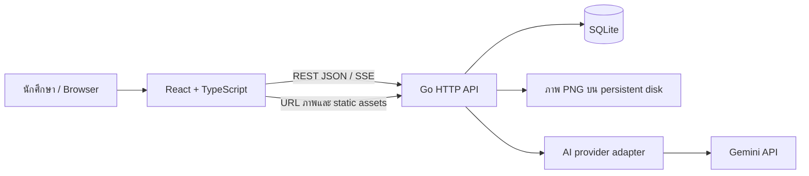

# EE Math I — แผนแยก React frontend และ Go backend

สถานะ: ข้อเสนอการออกแบบก่อน implementation

อัปเดตการตัดสินใจ 1 พฤศจิกายน 2026: ตามคำขอผู้ใช้ AI chat เปลี่ยนเป็น text-only ส่งข้อความโจทย์ของข้อที่เลือกและประวัติล่าสุดไม่เกิน 2 รอบ (งบ 4,000 ตัวอักษร) แทนภาพโจทย์/ภาพเฉลย ไม่ส่งคำอธิบายเฉลยที่เก็บไว้ เพิ่ม `/questions/{id}/context` และช่องแก้ข้อความก่อนส่ง โดยยังแยก conversation ตาม questionId ส่วนการออกแบบภาพในหัวข้อ AI ด้านล่างเป็นแนวทางรุ่นแรกที่ถูกแทนที่แล้ว ดูพฤติกรรมปัจจุบันและข้อจำกัด OCR ใน README.md

อัปเดตชุดเครื่องมือเรียน: เพิ่ม `/practice`, `/formulas`, `/progress`; ความคืบหน้า โน้ต รายการโปรด ชุดฝึก และ view state เก็บใน localStorage แบบ versioned ตามเครื่อง/เบราว์เซอร์ ส่วน Go สุ่มโจทย์ผ่าน `/practice/sets`, ให้สูตรและคำใบ้ผ่าน `/guides`, และเก็บ error reports ใน SQLite ผ่าน `/questions/{id}/reports` ตาม OpenAPI ปัจจุบัน ชุดฝึกใช้ timestamp deadline และซ่อนเนื้อหาเฉลยใน UI จนจบ เป็นเครื่องมือ self study; การตรวจคำตอบใช้ checklist กับ AI assistance ไม่ใช่การให้คะแนนอัตโนมัติ

## 1. เป้าหมายและขอบเขต

ย้าย `exam201_solutions.html` เป็นแอปที่แยกส่วนแสดงผล ข้อมูล และ AI ชัดเจน โดยระยะแรกคงการใช้งานเดิม: ค้นหา กรองหัวข้อ/ปี/ประเภท เปิดภาพโจทย์ เปิดภาพเฉลย อ่านคำอธิบาย AI ที่เตรียมไว้ และแชตถามเกี่ยวกับข้อที่เลือก

สมมติฐานเริ่มต้น: ใช้ส่วนตัวหรือกลุ่มเล็ก รัน Go หนึ่ง instance และเก็บข้อมูลบน persistent disk ของเครื่องนั้น เริ่มใช้งานบน localhost ก่อน การเผยแพร่ที่ใช้ API key ร่วมต้องเพิ่มระบบยืนยันตัวตนและโควตาก่อนเปิดให้บุคคลทั่วไป

โหมดฝึกทำข้อสอบ ความคืบหน้า โน้ต และซิงก์หลายอุปกรณ์เป็นระยะต่อไป เพื่อแยกการย้ายระบบออกจากการเพิ่มพฤติกรรมใหม่

## 2. สิ่งที่ตรวจพบจากไฟล์เดิม

| รายการ | ผลที่พบ |
|---|---|
| ขนาด HTML | 6,615,983 bytes ประมาณ 6.31 MiB |
| โจทย์ | 427 ข้อ |
| ภาพเฉลยต้นฉบับ | มีครบ 427 ข้อ |
| ข้อความสำหรับค้นหา `x` | มีครบ 427 ข้อ แต่ตัวอย่างมีสูตรที่แตกและข้อความเฉลยปน |
| หัวข้อ | ประกาศ 10 หัวข้อ มีโจทย์จริงในหัวข้อ 1–9 |
| Relevant Formulas | มีชื่อหัวข้อ แต่ไม่มีรายการโจทย์ ไม่ควรสร้างเนื้อหาขึ้นเอง |
| คำอธิบาย AI ที่เก็บไว้ `A` | 10 ข้อ จับคู่ด้วย `c-n` ได้ครบและไม่ซ้ำในชุดนี้ |
| รูปภาพ | ฝัง PNG แบบ base64 ในข้อมูล JavaScript |
| AI chat | browser เรียก Gemini โดยตรง เก็บ key ใน localStorage |

`n` เป็นเลขในคลังภายใต้หัวข้อ อย่าอนุมานว่าเป็นเลขข้อในกระดาษข้อสอบจริง ส่วน `a` เป็นป้ายเครดิตเดิมซึ่งยังไม่ยืนยันความหมายเต็ม จึงเก็บเป็น `sourceLabel`

## 3. สถาปัตยกรรม



- Frontend: React + TypeScript + Vite; SPA เนื่องจากงานหลักเป็นการค้นหาและอ่านโจทย์ผ่าน Go API และยังไม่มีความต้องการ SSR
- Backend: Go `net/http`; แบ่ง handler → service → repository และมี AI adapter แยกต่างหาก
- Database: SQLite สำหรับ corpus และประวัติแชต เหมาะกับขนาดข้อมูลและการรัน instance เดียว หากมีหลาย instance หรือ concurrent writes มาก ค่อยย้าย repository ไป PostgreSQL
- Media: แยกรูปเป็นไฟล์ ใช้ SHA-256 ของ bytes เป็นชื่อเพื่อ deduplicate และ cache ได้ โดยฐานข้อมูลเก็บ metadata และความสัมพันธ์
- Production: Go ให้บริการทั้ง React build, `/api/v1/*` และ `/media/*` ผ่าน origin เดียวกัน
- Development: Vite proxy `/api` และ `/media` ไป Go ไม่เปิด CORS แบบ wildcard

การแยก frontend/backend เป็นการแยก source code และหน้าที่ จึง deploy ร่วมกันได้ในระยะแรก โดยไม่ต้องดูแลหลายบริการ

## 4. Frontend และประสบการณ์ใช้งาน

เส้นทางหลัก:

- `/questions?topic=7&year=1998&type=Midterm&q=...&page=1`: รายการพร้อม filter ใน URL เปิดลิงก์เดิมและใช้ปุ่ม Back ได้
- `/questions/:id`: หน้าอ่านข้อเดียว พร้อมภาพ เฉลย และแชตของข้อนั้น

Component หลัก: `AppShell`, `TopicNav`, `QuestionFilters`, `QuestionList`, `QuestionCard`, `QuestionDetail`, `SolutionPanel`, `MathContent`, `ImageViewer`, `TutorPanel`

แบ่ง state ตามเจ้าของข้อมูล:

| State | ที่เก็บ |
|---|---|
| คำค้น ตัวกรอง หน้าปัจจุบัน | URL |
| ผล API และ cache | TanStack Query |
| panel ที่เปิด การซูม draft ข้อความ | component state |
| บทสนทนาและคำตอบที่บันทึกแล้ว | Go + SQLite |
| theme และขนาดตัวอักษร | localStorage |

ไม่เก็บ API key หรือภาพ base64 ใน client state ส่งข้อมูลรายการทีละ 20 ข้อและโหลดภาพแบบ lazy โดยมีขนาดภาพกำกับเพื่อลด layout shift ค้นหาหลังหยุดพิมพ์ประมาณ 300 ms และยกเลิก request เก่าเมื่อ filter เปลี่ยน

แสดงสถานะ loading, empty, error พร้อม retry ปุ่ม AI ที่ยังไม่มีคำอธิบายเตรียมไว้แสดงสถานะชัดเจน ไม่ให้เปิด panel ว่าง ปรับป้ายเป็น “เฉลยต้นฉบับ”, “คำอธิบายจาก AI” และ “ถาม AI”

KaTeX และ CSS bundle มากับ frontend เพื่อให้การอ่านสูตรไม่ต้องรอ CDN ใช้ React แสดงข้อความทั่วไป; Markdown ปิด raw HTML และ sanitize เนื้อหา HTML ที่นำเข้าก่อน render จำกัด KaTeX ไม่ให้ใช้ trusted commands

รูปมี alt ตามหัวข้อ/เลขในคลัง เปิดขยายด้วยคีย์บอร์ดได้ ปุ่มเปิดเฉลยมี `aria-expanded` และ panel มีชื่อที่โปรแกรมอ่านหน้าจอเข้าใจ โทนส้ม/เขียวและ mascot เดิมคงไว้ได้โดยใช้ design tokens

## 5. ข้อมูลและการระบุข้อ

ใช้ ID คงที่ เช่น `ee201-t01-q001` ซึ่งผูกกับรายการต้นทาง และเก็บ `legacyKey = "1-1"` เป็น unique key สำหรับ import ซ้ำ หลัง migration แล้ว ID จะไม่เปลี่ยนเมื่อแก้ชื่อหัวข้อหรือ metadata

ตารางหลัก:

| ตาราง | fields หลัก |
|---|---|
| `topics` | `id`, `name`, `sort_order` |
| `questions` | `id`, `legacy_key UNIQUE`, `topic_id FK`, `display_number`, `exam_type`, `exam_type_raw`, `exam_date NULL`, `date_label`, `year`, `source_label`, `search_text_raw` |
| `media` | `id` (SHA-256), `relative_path`, `mime_type`, `width`, `height`, `byte_size` |
| `question_media` | `question_id FK`, `role` (`question` / `original_solution`), `media_id FK`; unique(question_id, role) |
| `explanations` | `id`, `question_id FK`, `origin` (`imported_ai`), `body_html`, `review_status` (`unreviewed` / `reviewed`), `provenance_label` |
| `browser_sessions` | `id`, `token_hash UNIQUE`, `expires_at` |
| `conversations` | `id`, `session_id FK`, `question_id FK`, `created_at` |
| `messages` | `id`, `conversation_id FK`, `client_request_id`, `role`, `content`, `status`, `created_at` |
| `generation_requests` | `conversation_id FK`, `client_request_id`, `status`, `error_code`, `created_at`; unique(conversation_id, client_request_id) |

ไม่เพิ่ม review_status=reviewed ให้คำอธิบาย AI เดิมโดยอัตโนมัติ และไม่เดารุ่นโมเดลหรือเวลาสร้างถ้าไฟล์ไม่ได้ระบุ

เก็บวันที่ต้นฉบับเสมอ หาก parse ไม่สำเร็จให้ `exam_date = NULL` ส่วน `year` ใช้ค่าต้นทาง เก็บประเภทดิบควบคู่กับค่าที่ normalize เพื่อไม่ให้ subtype สูญหาย

สร้าง index ตาม `(topic_id, display_number, id)`, `year`, `exam_type` และ foreign keys การค้นหาระยะแรกใช้ parameterized substring search กับข้อความเดิมและ metadata เพื่อรองรับคำไทย/คำอังกฤษโดยไม่ต้องพึ่ง tokenizer ใหม่ จำกัดความยาวคำค้นและ escape wildcard เมื่อผู้ใช้ต้องการค้นข้อความตามตัวอักษร ไม่เพิ่ม FTS จนกว่าขนาดข้อมูลหรือผลวัดแสดงความจำเป็น

## 6. API contract

base path: `/api/v1`; ชื่อ JSON ใช้ camelCase; timestamp เป็น UTC ISO 8601

| Method | Path | หน้าที่ |
|---|---|---|
| GET | `/health` | ตรวจว่า process ยังตอบได้ |
| GET | `/catalog` | หัวข้อ จำนวนข้อ ปี ประเภท และสถานะเปิดใช้ AI |
| GET | `/questions` | รายการ ค้นหา filter และ pagination |
| GET | `/questions/{id}` | รายละเอียดและ URL ภาพโจทย์ |
| GET | `/questions/{id}/solutions` | URL ภาพเฉลยและคำอธิบาย AI ที่มีอยู่ |
| POST | `/session` | สร้าง anonymous browser session cookie |
| POST | `/conversations` | เปิดแชตใหม่ของ questionId ที่ระบุ |
| GET | `/conversations/{id}/messages` | อ่านข้อความของ session เจ้าของ |
| POST | `/conversations/{id}/messages` | ส่งคำถามและ stream คำตอบแบบ SSE |
| GET | `/media/{sha256}.png` | อ่านภาพจากไฟล์ที่ลงทะเบียนไว้ |

รายการตัวอย่าง:

```http
GET /api/v1/questions?topicId=7&year=1998&examType=Midterm&q=Laplace&page=1&pageSize=20
```

```json
{
  "items": [{
    "id": "ee201-t07-q001",
    "topicId": 7,
    "displayNumber": 1,
    "questionImage": {"url": "/media/<sha256>.png", "width": 800, "height": 240},
    "hasOriginalSolution": true,
    "hasAIExplanation": true
  }],
  "total": 12,
  "page": 1,
  "pageSize": 20
}
```

ตัวเลขและ dimensions ใน JSON นี้เป็นตัวอย่าง schema ไม่ใช่ค่าที่วัดจากโจทย์ข้อดังกล่าว รายการส่ง metadata ปี/ประเภท/ป้ายวันที่/เครดิตเพิ่มเติมตาม question model แต่ไม่ส่งภาพเฉลย ข้อความเฉลย หรือ base64

`pageSize` ค่าเริ่มต้น 20 สูงสุด 100; ลำดับคงที่ตาม topic, displayNumber, id; filter ใช้ AND และคำค้นค้นในขอบเขต metadata/ข้อความที่กำหนด คืน `total` หลังใช้ filter ทั้งหมด; จำนวนหัวข้อใน `/catalog` เป็นยอดทั้งคลังและระบุชื่อ `totalCount` ชัดเจน

ข้อผิดพลาดก่อนเริ่ม stream:

```json
{"error":{"code":"QUESTION_NOT_FOUND","message":"ไม่พบโจทย์ข้อนี้","requestId":"..."}}
```

ใช้ 400 สำหรับ input ไม่ถูกต้อง, 404 สำหรับรายการที่ไม่มีหรือไม่ได้เป็นเจ้าของ, 409 สำหรับคำขอซ้ำที่ยังทำงาน/แชตกำลังตอบ, 429 สำหรับโควตา, 503 เมื่อ AI ไม่พร้อม และ 502/504 เมื่อ upstream ผิดพลาด/หมดเวลา ไม่ส่ง API key หรือข้อความ error ภายในจาก provider ไป client

## 7. AI chat และ streaming

1. React ส่ง `{questionId}` เพื่อเปิด conversation; Go ตรวจว่ามีโจทย์จริงและผูกกับ browser session
2. แต่ละ conversation ผูกกับหนึ่งโจทย์เสมอ เปลี่ยนข้อแล้วเปิดหรือเลือก conversation ของข้อนั้น ประวัติจากอีกข้อไม่ติดมาด้วย
3. React ส่ง `{message, clientRequestId}` ไป message endpoint ผ่าน `fetch` แล้วอ่าน response stream เพราะ request นี้เป็น POST
4. Go อ่านโจทย์/ภาพ/เฉลยและประวัติที่อนุญาตจากระบบเอง ประกอบ prompt ใน AI adapter โดย client ไม่ส่ง system prompt, arbitrary image URL หรือประวัติที่อ้างว่าเป็นข้อความของโมเดล
5. เนื้อหาภาพโจทย์เป็นหลักฐานหลัก ใช้ OCR เป็นข้อมูลช่วยที่อาจผิด และติดป้ายเฉลยต้นฉบับเป็น reference ที่อาจพิมพ์ผิด
6. Go แปลง provider stream เป็น event ของระบบ แล้ว frontend ค่อย render สูตรเต็มหลังคำตอบจบ เพื่อลดสูตรกระพริบระหว่างพิมพ์

ตัวอย่าง SSE:

```text
event: start
data: {"messageId":"msg_123"}

event: delta
data: {"text":"เริ่มจากหา integrating factor"}

event: done
data: {"messageId":"msg_123","status":"completed"}
```

เมื่อ error หลังส่ง header แล้ว ให้ส่ง `event: error` พร้อม code และ requestId จากนั้นปิด stream ไม่พยายามเปลี่ยน HTTP status

ป้องกันคำขอซ้ำด้วย `(conversationId, clientRequestId)` หากสำเร็จแล้วคืนคำตอบเดิม หากยังทำงานอยู่คืน 409 และอนุญาต generation พร้อมกันหนึ่งรายการต่อ conversation การบันทึกข้อความและ request status ทำใน transaction สั้น ๆ โดยไม่ถือ transaction ค้างระหว่างเรียก AI

เมื่อยกเลิก/ตัดการเชื่อมต่อ ให้ยกเลิก upstream ด้วย Go context และเก็บคำตอบบางส่วนพร้อมสถานะ interrupted; ไม่นำคำตอบบางส่วนไปเป็นประวัติของโมเดล และใช้การกดลองใหม่เพื่อสร้าง request ใหม่ หาก refresh หลังสำเร็จสามารถอ่านคำตอบจาก messages endpoint

กำหนด input limit, history/token budget, timeout, session quota และ global concurrent generation limit; ไม่ retry งาน generation ที่เริ่มส่งคำตอบแล้วอัตโนมัติ เก็บ key/model/thinking options ใน environment ฝั่ง Go และเลือกโมเดลที่ยืนยันว่า account ใช้ได้ในขั้น implementation ไม่ยึดชื่อ default ใน HTML เป็นข้อเท็จจริง

หากไม่มี AI key หน้าโจทย์และเฉลยที่เก็บไว้ยังทำงาน และ `/catalog` แจ้งว่า chat unavailable

anonymous session ใช้ cookie แบบ opaque random token, HttpOnly, SameSite และ Secure เมื่อใช้ HTTPS; เก็บเฉพาะ token hash ฝั่ง server ตรวจเจ้าของ conversation ทุกครั้ง และตรวจ Origin ของ mutation ไม่ถือว่า guest cookie เป็นระบบสมาชิกหรือวิธีป้องกันคนภายนอกใช้โควตา

## 8. โครงสร้าง repository ที่เสนอ

```text
frontend/
  src/
    app/                 # routing, providers, shell
    features/questions/  # filters, list, detail, API hooks
    features/solutions/  # original/AI explanation panels
    features/tutor/      # chat, SSE, message state
    components/          # math renderer, image viewer, controls
    lib/                 # HTTP client and shared helpers
    styles/
  package.json
backend/
  cmd/server/
  cmd/import-legacy/     # one-time/idempotent import CLI
  internal/
    httpapi/             # routes, handlers, middleware, DTOs
    catalog/             # question and solution services
    tutor/               # conversation orchestration
    ai/                  # provider interface + Gemini adapter
    storage/sqlite/      # repositories and migrations
    config/
  go.mod
contracts/
  openapi.yaml           # REST และ SSE event schema
data/                    # runtime DB + media; ไม่ commit ข้อมูลแชต
docs/
exam201_solutions.html   # ต้นทางสำหรับ migration
SYSTEM_DESIGN.md
```

เริ่มด้วย monorepo เพื่อแก้ API และ UI ใน change เดียวกัน ใช้ OpenAPI เป็น contract และสร้าง TypeScript types จาก contract เมื่อเริ่ม implementation; ไม่ทำ generic repository/framework ที่ยังไม่มีการใช้งาน

## 9. แผน migration และการตรวจรับ

1. สร้าง importer อ่าน JSON ของ D และ A แบบ parse ข้อมูล ไม่ execute JavaScript จาก HTML
2. แยก base64 เป็น PNG ตรวจ signature/ขนาด ทำ hash และบันทึกผ่าน staging directory
3. นำเข้าหัวข้อ 10 รายการ โจทย์ 427 รายการ ความสัมพันธ์ภาพ 854 รายการ และคำอธิบาย AI 10 รายการ จำนวนไฟล์ภาพจริงอาจน้อยกว่า 854 เมื่อมีภาพซ้ำ
4. ตรวจ duplicate key, malformed image, AI key ที่ไม่มีโจทย์ และข้อมูลสำคัญที่หาย ให้ import ล้มเหลวพร้อมรายงาน แทนการข้ามเงียบ ๆ
5. commit ข้อมูลเมื่อ media พร้อม; ใช้ upsert ตาม legacy key/content hash และบันทึก checksum ของ source เพื่อรันซ้ำแล้วไม่เพิ่มข้อมูลซ้ำ การรันซ้ำจาก source ที่แก้ไขต้องรักษา question IDs เดิมและไม่ลบแชต
6. ทำ Go catalog API และ React หน้าอ่านให้ใช้ข้อมูลชุดใหม่ได้ จากนั้นย้าย AI chat ผ่าน Go
7. ตรวจค้นหา/ตัวกรองเทียบ semantics เดิม เปรียบเทียบภาพก่อนและหลัง เปิดครบทุกชนิดเฉลย และตรวจ layout บนมือถือ/desktop

เงื่อนไขรับงานตอน implementation:

- จำนวนรายการตรงกับต้นทาง ภาพ decode แล้วให้ bytes ตรงกัน และคำอธิบาย AI ไม่สลับข้อ
- import ซ้ำแล้วจำนวนและ IDs ไม่เปลี่ยน
- browser ไม่มี provider API key และไม่เรียก provider โดยตรง
- เปลี่ยน filter และ Back แล้วคืนรายการ/ตำแหน่งที่คาดไว้ได้; โหลดหน้า detail จาก URL ได้โดยตรง
- filter/search/pagination มี integration checks และไม่หลุดขอบเขต filter
- chat ไม่ปะปนโจทย์ ไม่อ่าน conversation ของ session อื่น และจัดการ timeout/disconnect/duplicate request ได้
- build React และ Go ผ่าน; ตรวจเส้นทางจริงตั้งแต่เปิดรายการ → อ่านเฉลย → ถาม AI โดยใช้ mock provider ก่อนทดสอบ provider จริงตาม key ที่ตั้งไว้

## 10. การ deploy และการขยายภายหลัง

Go เสิร์ฟ frontend build และ media จาก allowlist ของ ID/path ในฐานข้อมูล SPA fallback ใช้เฉพาะ frontend routes ไม่ตอบ index.html แทน API/media 404 ภาพที่ใช้ content hash ตั้ง immutable cache ได้ ข้อมูล API ใช้ cache ที่เหมาะกับการแก้ไข corpus

เก็บ SQLite และ media บน persistent local volume และ backup เป็นชุดที่สอดคล้องกัน ตั้ง requestId, duration, status และ error code ใน log โดยไม่ log key/ข้อความแชต/ภาพเต็ม จำกัด retention ของ session/chat และ cleanup ตามค่าที่ตั้งไว้ เช่น 30 วัน

ระยะต่อไปเพิ่ม practice sessions และ study progress โดยอ้าง stable questionId เดิม หากต้องใช้หลายอุปกรณ์ให้เพิ่ม accounts และ owner checks ก่อน sync เมื่อจะเพิ่มหลาย Go replicas ให้ย้าย SQLite ไปฐานข้อมูล server และ media ไป object storage; ย้าย rate limit/session coordination ไป shared storage ตามความจำเป็น

ข้อจำกัดที่ต้องรับรู้: แยกเป็น web app แล้วต้องเปิด server เพื่ออ่านคลังในระยะแรก การเปิดไฟล์ HTML แบบ standalone และ offline แบบสมบูรณ์ต้องออกแบบ PWA/export เพิ่ม ส่วนการค้นหาที่แยกเฉพาะโจทย์และโหมดฝึกที่ไม่เผยคำตอบ ต้องแยกข้อความ OCR ของโจทย์ออกจากเฉลยก่อน เพราะ `x` เดิมมีเนื้อหาปนกัน

## เอกสารอ้างอิงประกอบการเลือกเทคโนโลยี

- React: SPA build tools และ tradeoffs — https://react.dev/learn/build-a-react-app-from-scratch
- Go: HTTP server/client และ streaming primitives — https://pkg.go.dev/net/http
- SQLite: ขอบเขตการใช้ฐานข้อมูลแบบ local และเว็บไซต์ — https://sqlite.org/whentouse.html

### การตรวจเลือกตอบจากเฉลยต้นฉบับ

คำตอบนักเรียนใช้ token mcq:version:optionId เก็บในช่อง answer เดิมเพื่อคงข้อมูลเก่า เฉลยถูกเก็บใน Go embedded JSON ผูก SHA-256 ของภาพต้นฉบับ GET choices ส่งเฉพาะ 4 options; POST choices/check ตรวจ ID กับ key โดยไม่ใช้โมเดล AI รุ่นเฉลยที่เปลี่ยนและคำตอบข้อความเดิมนับเป็น ungraded ไม่หักคะแนน ชุดฝึกสุ่มเฉพาะข้อที่มี key ตรงกับ source และ UI แสดงผลตรวจหลังจบตาม timestamp ระบบนี้เป็นเครื่องมือฝึกส่วนตัว ผู้ใช้ยังเรียก API/เปิดเฉลยในหน้าอื่นได้ จึงไม่ใช่ระบบคุมสอบ

คลังเริ่มต้นมี 10 keys ครอบคลุม 9 topics โดย Fourier Transforms ข้อแรกฝึกเฉพาะข้อ b ตาม prompt; ข้อที่เหลือต้องเตรียมตัวเลือกและตรวจจากภาพก่อนเปิดให้คะแนน
